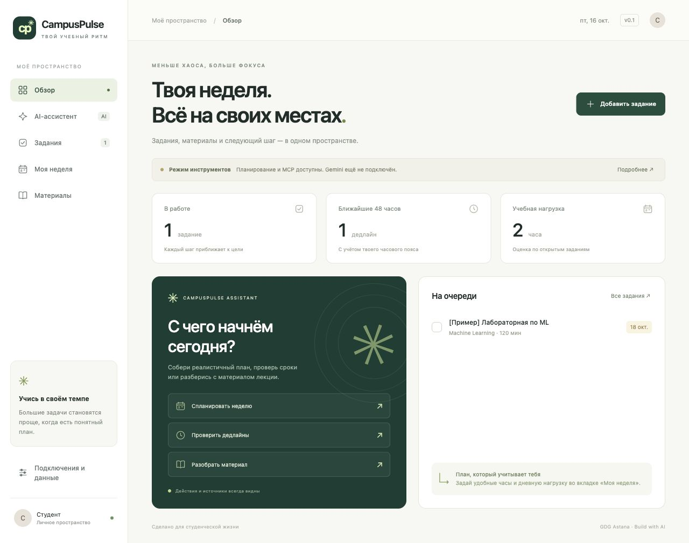

# CampusPulse AI

Студенческий помощник для кейса **GDG Astana · Build with AI**. Задания, реалистичный план недели, материалы лекций и GitHub issues в одном интерфейсе. Gemini самостоятельно выбирает инструменты в ограниченном цикле; пользователь видит вызовы, результаты и источники.



## Статус первой версии — 16 октября 2026

- Реализованы веб-приложение, Gemini agent core, настоящий MCP-сервер, инструменты, хранение данных и скрипты GCP.
- Проверены локальное приложение, 35 автоматических тестов и отдельный живой запрос GitHub через MCP. Тесты агента используют явно обозначенную подмену только на границе Gemini SDK; это **не доказательство живого инференса**.
- Созданы закрытый репозиторий `tomirizz/campuspulse-ai` и GCP-проект `campuspulse-ai-511817`.
- **Облачное развёртывание отложено владельцем**: к проекту ещё не подключён биллинг. Живой вызов Gemini, Agent Engine API, Firestore и Cloud Run пока не проверены. Обязательный облачный пункт ТЗ ещё не закрыт.
- Dockerfile подготовлен; контейнер не проверен запуском, поскольку Docker daemon на машине был выключен.

## Быстрый запуск

Нужны Python 3.11–3.13 либо [uv](https://docs.astral.sh/uv/). Node.js для работы приложения не требуется.

```bash
git clone https://github.com/tomirizz/campuspulse-ai.git
cd campuspulse-ai
bash scripts/run.sh
```

На macOS можно открыть `Запустить CampusPulse.command`. Первый запуск создаст `.venv`, установит зафиксированные зависимости и скопирует `.env.example` в `.env`.

Открыть **http://127.0.0.1:8765**. Завершение сервера: Ctrl+C в его терминале. Если порт занят другой копией приложения, остановить её либо запустить с `PORT=8766 bash scripts/run.sh`.

По умолчанию `AGENT_MODE=tools`: работают реальные инструменты и планировщик, но **это не автономный ИИ**. Приложение не переключается на этот режим молча при ошибках Gemini.

## Как пользоваться

1. В «Заданиях» добавить курс, дедлайн с временем и оценку длительности. Задания можно изменить, завершить или удалить.
2. В «Моей неделе» указать часовой пояс, дневную нагрузку, часы занятий и занятые интервалы. План показывает перегрузку и экспортируется в `.ics` для календаря.
3. В «Материалах» загрузить свой PDF/TXT/MD. Включённый Gemini отвечает по тексту с указанием имени файла и страницы. В режиме инструментов доступно чтение фрагмента, без имитации анализа ИИ.
4. В чате попросить: «Проверь GitHub issues в googleapis/python-genai». Источник запрашивается в момент обращения, через MCP.
5. В «Подключениях и данных» можно проверить интеграцию, добавить **явно помеченные синтетические примеры** или удалить своё пространство.

## Подключение Gemini локально

Основной путь по ТЗ — Vertex AI. Нужны Google Cloud CLI, проект с биллингом, включённый Vertex AI API и права пользователя.

```bash
gcloud auth application-default login
gcloud auth application-default set-quota-project campuspulse-ai-511817
```

В локальном `.env`:

```dotenv
AGENT_MODE=gemini
GOOGLE_CLOUD_PROJECT=campuspulse-ai-511817
GEMINI_LOCATION=global
GEMINI_MODEL=gemini-3.6-flash
```

Затем `python -m scripts.preflight --live` из активированной `.venv`. Этот флаг делает небольшой реальный запрос Gemini и может расходовать средства. Обычный `python -m scripts.preflight` проверяет MCP и Google ADC без генерации.

Для разработки также поддерживается `GEMINI_API_KEY` в `.env` без `GOOGLE_CLOUD_PROJECT`. Это альтернативный локальный способ; он не заменяет обязательное развёртывание Agent Engine. Не вставлять ключи в исходники, чат, снимки экрана или GitHub.

Модель задаётся настройкой, без автоматической подмены. Примеры Gemini 1.5 из исходного задания устарели; перед облачным запуском проверить доступность выбранной модели в своём проекте. Источник: [актуальная документация Gemini Flash](https://docs.cloud.google.com/gemini-enterprise-agent-platform/models/guides/gemini-3-6-flash).

## Google Cloud

Пошаговая инструкция: [docs/DEPLOYMENT.md](docs/DEPLOYMENT.md). В проекте есть точный вызов `reasoning_engines.ReasoningEngine.create`, указанный в ТЗ. После создания ресурса отдельно проверяется реальный удалённый запрос, затем публикуется приватный Cloud Run frontend. Создание ресурса само по себе не считается проверенным API.

## Архитектура

```text
Browser → FastAPI (Cloud Run)
              ├─ SQLite local / Firestore cloud: tasks, materials, history
              └─ Agent Engine :query
                   └─ CampusPulseAgent → Gemini
                        ├─ MCP client → stdio server → GitHub API / system clock
                        └─ custom functions → planner / uploaded materials / task proposal
```

В локальном режиме тот же agent core вызывается в процессе FastAPI. Agent Engine получает ограниченный контекст одной сессии от сервера; сам не хранит данные пользователей. Ключи и API-клиенты не сериализуются при развёртывании.

| Папка | Содержимое |
|---|---|
| `campuspulse/agent.py` | Gemini loop, предел шагов, сериализуемый GCP-класс |
| `campuspulse/mcp_server.py` | Настоящий MCP stdio сервер и внешний GitHub API |
| `campuspulse/tools.py` | MCP discovery, проверка аргументов, allowlist, custom tools |
| `campuspulse/planner.py` | Дедлайны, свободные интервалы, нагрузка, экспорт ICS |
| `campuspulse/server.py` | API, сессии, загрузки, удалённый клиент Agent Engine |
| `web/` | Адаптивный интерфейс без сборки и внешних CDN |
| `scripts/` | Запуск, preflight, облачная инфраструктура и проверки |
| `tests/` | Регрессии, MCP, agent contract, API и изоляция сессий |
| `docs/` | ТЗ, инструменты, сценарий демонстрации, ограничения |

## Проверки

```bash
source .venv/bin/activate
python -m pytest -q
python -m pytest -q -m live  # отдельно: настоящий сетевой запрос GitHub
node --check web/app.js     # необязательная локальная синтаксическая проверка
```

GitHub Actions запускает офлайн-набор и проверку JavaScript. `requirements.lock` фиксирует проверенные версии. Для обновления зависимостей нужна отдельная проверка: не заменять версии автоматически перед выступлением.

## Безопасность и ограничения

- Источники — введённые задания, загруженные файлы и актуальный GitHub API. Предзаполненной базы университетских данных нет.
- MCP-процесс не получает Google/Gemini credentials. Внешние запросы разрешены только к фиксированному GitHub API; приватные репозитории в v0.1 исключены.
- LLM не пишет данные самостоятельно. `propose_task` создаёт предложение; сохранение требует действия пользователя в форме.
- Журнал содержит наблюдаемые действия, аргументы и результаты, **не скрытую цепочку размышлений модели**. Экспорт журнала может содержать ваш текст: проверяйте его перед публикацией.
- Файлы: до 5 МБ, 20 страниц, 60 000 символов; 10 материалов и 100 заданий на сессию. Для сканов нужен внешний OCR. Оригинал файла не сохраняется, сохраняется извлечённый текст.
- Не больше 8 раундов модели / 12 инструментов; таймауты, явные ошибки, отсутствие скрытого fallback.
- Пространство привязано к случайной HttpOnly cookie; полноценные аккаунты, восстановление и работа на нескольких устройствах — следующий этап. Публичный многопользовательский запуск требует отдельной авторизации и квот. Cloud Run по умолчанию приватный.
- Планировщик использует оценки времени, блоки до 60 минут и шаг 15 минут. Он не резервирует перерывы автоматически и не гарантирует результат учёбы.
- GitHub возвращает ограниченную свежую выборку; сроки сдачи из отсутствующих данных не выводятся.

Карта требований: [docs/REQUIREMENTS.md](docs/REQUIREMENTS.md). Презентация: [docs/CampusPulse_AI_v1.pptx](docs/CampusPulse_AI_v1.pptx).
