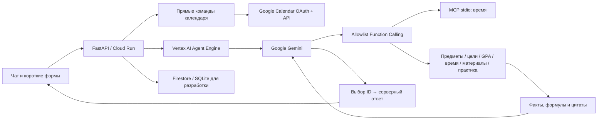

# Архитектура CampusPulse AI

## Границы ответственности

- `agent.py`: Gemini SDK и ограниченный reasoning loop. `tools_only_run` — явно обозначенные правила без ИИ, доступные до настройки облака.
- `tools.py`: JSON Schema, allowlist, доступ только к материалам/данным переданной сессии. Модель не получает write-инструмент календаря, исполнение shell или произвольные URL.
- `evidence.py`: факты из реальных результатов; Gemini выбирает их ID. Финальный текст модели, придуманные числа и код не отображаются.
- `study.py`: лексический поиск с цитатами, разбор строк силлабуса, сравнение планов, Decimal-расчёт оценки, вопросы из исходного материала, Python compile/JSON parser без исполнения.
- academic.py: подтверждённые предметы, точная арифметика, несколько неизвестных оценок, достижимые цели, редактируемый GPA, объяснимые приоритеты. Равномерный план отличается от условных минимумов.
- academic_import.py / academic_ocr.py: консервативный импорт названия, кредитов, вложенных весов и дат расписания; доступное локальное OCR изображений. Неполная схема не нормализуется до 100%.
- academic_planner.py: занятость, кредиты, сложность, риск и сроки → план без пересечений. Обычно 25–50 минут работы с перерывами; оценка временем не гарантируется.
- academic_api.py: явное сохранение предметов, оценок, шкалы, настроек и расписания; проверка импорта. Образец HPC обозначен как пример.
- academic_schedule.py: нормализованное название или уникальный акроним и однозначный тип оценочной работы → срок для расчёта плана. Неоднозначность не угадывается; оценки не переписываются.
- notebooks.py / notebook_api.py: конспект по 1–10 материалам с точными цитатами, определениями и самопроверкой; сохранение в пространстве и экспорт PDF/MD/TXT/HTML. Без Google доступна явно обозначенная экстрактивная версия.
- notebook_ai.py: необязательный ограниченный вызов настроенного Gemini, структурированный педагогический пересказ и проверка ссылок/чисел. Исходные цитаты сохраняются. Некорректный ответ или ошибка дают явное предупреждение и локальную версию; успешная метка Gemini появляется только после проверки.
- `quests.py` / `progress.py`: подтверждённый банк вопросов, сравнение с эталоном, атомарные ответы и уникальные награды. Общий XP = награды завершённых миссий + 10 × уникальные освоенные факты. Уровень = 1 + floor(XP / 100). Серия/этапы миссий остаются привязаны к выполненным заданиям.
- `calendar_dialogue.py` / `dates.py`: состояние незавершённого запроса и явная грамматика дат. Без дня/времени — уточнение, прошлый срок не переносится на следующий год молча. Длительность без указания — настройка, по умолчанию 60 минут. Неподдерживаемые повторы/диапазоны требуют уточнения.
- `google_calendar.py`: OAuth с state, PKCE, TTL и одноразовым callback; шифрованные токены; refresh, отзыв, пагинация, одноразовые события, стабильный ID. Успех только по полученному ответу Google, сверка параметров при 409.
- `features_api.py`: формы используют те же функции, что и агент; сохранение настроек и эталонов только через пользовательские формы.

## Календарный поток

1. Прямое «запланируй…» распознаёт сервер. Документ, найденная цитата или текст модели не могут инициировать запись.
2. Параметры берутся из сообщений; отсутствующие поля уточняются. Относительные даты вычисляются от часов сервера в выбранном поясе.
3. Если нет OAuth-разрешения, запрос сохраняется незавершённым. Вход Google сам по себе не создаёт событие: после него пользователь нажимает сохранение либо пишет «сохрани».
4. Google events.list проверяет пересечения. При них требуется новое время либо явное «всё равно» для текущего набора пересечений.
5. events.insert использует один ID для одинаковых параметров в этой сессии; повтор при сбое/409 читает и сверяет существующее событие. Приглашения не отправляются.
6. В ответе — фактический Google ID, время и ссылка. Журнал показывает API-запрос без заголовков авторизации.

Это осознанно детерминированный путь записи; автономный выбор Gemini демонстрируется в read-only многошаговых сценариях (найти материал → прочитать → выбрать цитату, сравнить планы и т. п.).

## Данные и защита

Случайная 256-битная HttpOnly SameSite=Lax cookie разделяет пространства и позволяет OAuth callback. POST другого Origin блокируется. OAuth state привязан к cookie, действует 10 минут и потребляется атомарно. Refresh/access tokens шифруются Fernet: локально ключ в `data/.calendar-token-key` с 0600; в облаке — стабильный секрет из Google Secret Manager. В `workspace`, Gemini context, MCP env и trace токенов нет.

MCP — отдельный процесс, которому не передаются Google credentials. Gemini получает только результаты разрешённых инструментов. Динамический UI использует textContent, не вставляет текст файлов как HTML. Проверка Python создаёт объект кода, но не исполняет его. API ограничивает размеры/число файлов и данные форм.

Все новые коллекции очищаются вместе с пространством. Удаление локальных данных не удаляет события Google; кнопка отключения отдельно отзывает разрешение. Настоящие облачные permissions/Firestore transactions ещё требуют live-проверки.

## Границы реализации

Поиск лексический, без embeddings; расхождения чисел требуют сверки. Импорт поддерживает плоские проценты и вложенные аттестации; потерянные коэффициенты и неоднозначные таблицы требуют проверки. Качество OCR зависит от картинки и доступного движка. Экзамены не превращаются в еженедельные пары.

Новый учебный контур поддерживает несколько неизвестных оценок, различает совместный план и условные минимумы. Старый калькулятор «Практики» остаётся инструментом одной неизвестной. Допуск, обязательный минимум экзамена и специальные правила вуза не предполагаются. Квесты проверяют воспроизведение подтверждённого текста, не понимание в целом.

Calendar поддерживает основной календарь и отдельные события; редактирование и повторения не реализованы. Живые Gemini, Agent Engine, Cloud Run, Firestore и Calendar OAuth проверяются отдельно: наличие кода не подтверждает подключение. Подробнее: [ACADEMIC.md](ACADEMIC.md), [DEPLOYMENT.md](DEPLOYMENT.md).
