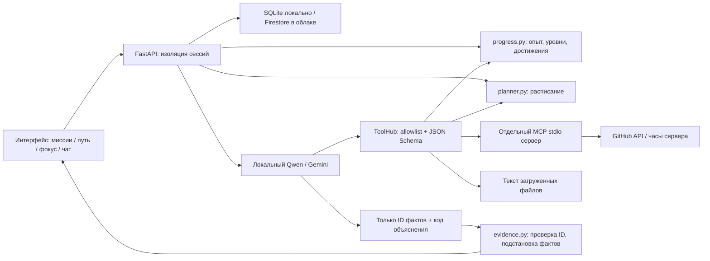

# CampusPulse v0.2: геймификация и проверяемые ответы

## Границы модулей

Модель определяет релевантный инструмент и выбирает факты, но не рассчитывает значения, не пишет исполняемый код и не переписывает цитаты. Итоговый текст состоит из объяснения по типу источника и фактов, подставленных сервером. Это намеренно ограниченный, проверяемый ассистент по учебному пространству, а не универсальный чат. По вопросу вне доступных источников система сообщает о нехватке данных. Качество выбора релевантного фрагмента всё ещё зависит от модели: структурная проверка исключает выдуманный текст, но не доказывает семантическую релевантность выбранной цитаты.

## Геймификация: правила progress-v1

Все баллы — игровые показатели самостоятельной организации, **не оценки знаний, способности или успеваемости**. Нет сравнения студентов, штрафов за пропуск или наград за пустые клики. Выполнение отмечает сам студент; система не подтверждает фактическую сдачу работы.

| Показатель | Формула / правило | Источник |
|---|---|---|
| XP задания | `20 + min(40, 5 × ceil(minutes / 30))` | `estimated_minutes` пользователя при первом завершении |
| Общий XP | сумма наград заданий с `completed=true` | сохранённые `reward_snapshot` |
| Уровень | `1 + floor(XP / 100)` | общий XP |
| Прогресс уровня | `XP mod 100` | общий XP |
| До нового уровня | `100 − (XP mod 100)` | общий XP |
| Серия | последовательные даты завершения, заканчивающиеся сегодня или вчера | `completed_at` сервера в выбранном часовом поясе |
| Цель недели | 3 задания с понедельника; `min(100, floor(count × 100 / 3))` | даты первого завершения активных наград |
| Достижения | завершено не меньше 1 / 3 / 5 / 10 / 20 заданий | число активных наград |
| Нагрузка | `round(sum(estimated_minutes) / 60, 1)` | открытые задания |
| Фокус | `max(0, ceil((end_ms − now_ms) / 1000))` | часы браузера; 25 минут — настройка продукта |

Коэффициенты награды, пороги и длительность фокуса — **явные продуктовые решения**, не научно доказанная оптимизация мотивации. Они хранятся в коде, версия правил записывается с наградой. «Почему?» показывает фактические входные значения, формулу, источник и результат.

### Жизненный цикл награды

1. При первом завершении одна транзакция сохраняет статус, время сервера и снимок минут/XP/версии правила в той же записи задания.
2. Повторный `PATCH completed=true` идемпотентен. Параллельные запросы не создают второй награды: SQLite использует `BEGIN IMMEDIATE`, Firestore — транзакцию.
3. Возврат в работу исключает награду из общей суммы, сохраняя снимок. Повторное завершение возвращает тот же XP и прежнюю дату.
4. Редактирование оценки времени после первого завершения не меняет снимок награды. Удаление задания убирает его награду из суммы.
5. Старые выполненные задания v0.1 не получают выдуманную дату или ретроспективный опыт. Пользователь может вернуть их в работу и завершить явно.

Это защита от повторного начисления, а не античит для соревнований. Пользователь может создавать новые задания и сам отмечать их выполненными. Публичного рейтинга нет.

## Контракт «почему»

`proof = {title, formula, inputs, result, source, note, version}`.

- Расчёт: формула и реальные операнды.
- Задание: введённые пользователем поля, идентификатор записи.
- Материал: имя файла, страница, строка извлечённого текста, диапазон символов, точная цитата. Нумерация строк не имитирует исходную вёрстку PDF.
- GitHub: URL issue, поле API и время получения. Выборка ограничена; из неё не выводится общее число всех issues.
- Ответ модели: существующие ID фактов и код из `EXPLANATIONS`. Свободный текст модели не отображается. Неизвестные ID и невалидный JSON приводят к ответу о нехватке данных.
- Ошибки: причина проверки и источник ограничения. Не маскируются под успешный ответ.
- История: новые ответы сохраняются вместе с источниками; старые ответы отмечаются как не имеющие нового формата доказательств.

## Локальный ИИ без ключа

Ollama слушает только loopback. Модель Qwen3 1.7B загружается один раз (около 1,4 ГБ); нужен интернет для первой загрузки и GitHub. Дальнейший инференс не требует API-ключа, регистрации или облачного биллинга. Автозапуск на macOS скачивает официальный runtime с зафиксированной версией и проверяет SHA-256. На Linux/Windows используется установленный Ollama. Производительность зависит от памяти/процессора; это не обещание запуска на любом устройстве.

Для явного запроса числовой метрики (опыт, уровень, план, дедлайн) локальный режим сначала вызывает обязательный источник по детерминированному правилу. Запрос GitHub с owner/repo также проверяется напрямую. Эти шаги в журнале помечены «Правило запроса», а не приписаны модели. Локальная модель выбирает факты для ответа; в вопросах по материалам также выбирает файл/страницы. Это честное разделение: полный autonomous tool loop сохранён в Gemini, а бесплатный локальный путь делает ставку на проверяемость.

В локальном режиме модель выбирает дополнительное действие через JSON Schema с enum допустимых действий; параметры формируются из схемы инструмента, репозитория в запросе и метаданных прочитанных файлов. Затем ToolHub вызывает настоящую функцию/MCP. В Gemini сохраняется native Function Calling.

Локальный режим ограничивает цикл инструментов и запросы, блокирует удалённый адрес Ollama, не передаёт Google credentials MCP-процессу. Модель не получает инструмент выполнения кода. По сети приложение обращается к GitHub только через фиксированный API и проверенный `owner/repository`.

Документация поставщика: [Ollama chat API](https://docs.ollama.com/api/chat), [structured outputs](https://docs.ollama.com/capabilities/structured-outputs), [модель](https://ollama.com/library/qwen3:1.7b).

## Соответствие хакатону

Gemini и Agent Engine сохранены как отдельный обязательный путь. Локальная Qwen не заменяет Gemini в критериях GDG Astana. Облачный запуск отложен владельцем; презентация v0.1 — старый черновик, новая презентация будет подготовлена только после финализации продукта. См. `REQUIREMENTS.md`.
